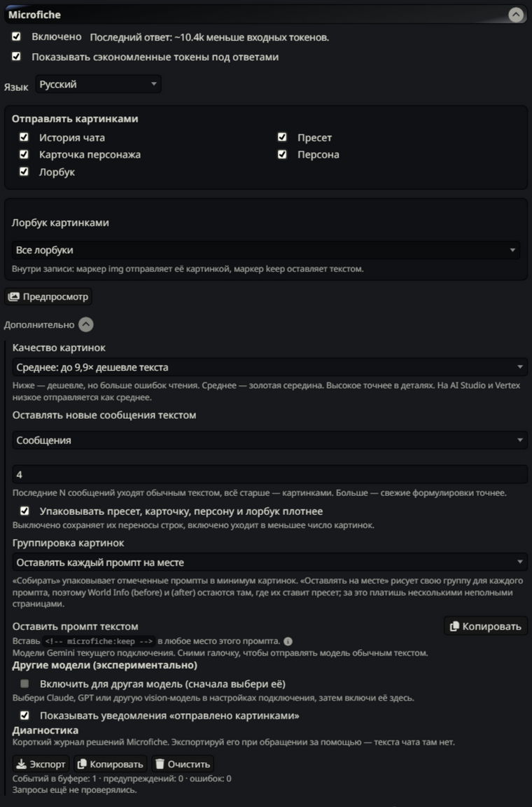
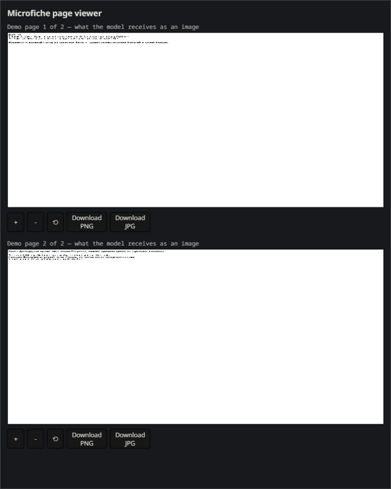
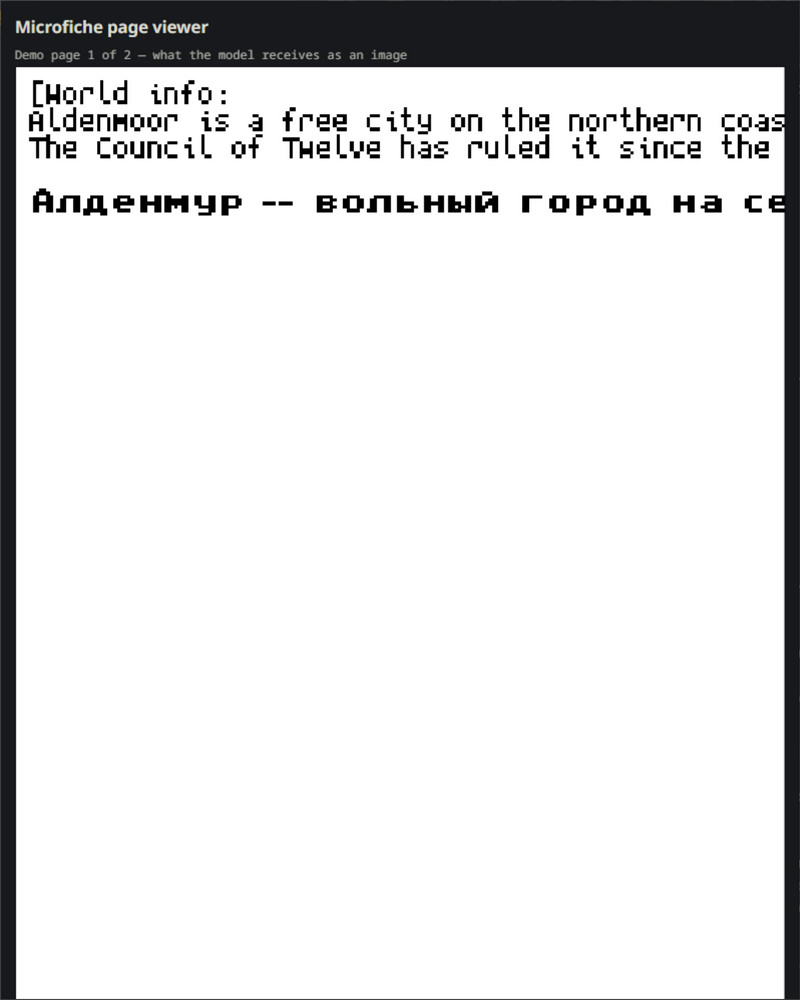

# Microfiche: send the prompt as pages, cut the input bill

Microfiche takes the parts of the prompt that do not need to be quoted verbatim — older chat history, the preset, the character card, the persona description, world info (lorebooks) — renders them as compact pixel-font page images, and swaps those pages into the request. The model reads the pages like a scanned book. Input tokens drop by up to 80%, while the newest messages stay as exact text.

This is a standalone, extended edition of [Microfiche](https://github.com/cata02222/SillyTavern-Microfiche) by **cata02222** under the same AGPL-3.0 license. It differs from the original (v0.3.0) quite a bit — in short:

- **Russian UI** — bilingual RU/EN: follows SillyTavern's language or is fixed in settings;
- **Lorebook page conversion is fixed** — because of SillyTavern's entry ordering, a block used to send a single entry as an image; now all of them go;
- **Page viewer** — zoom via buttons, Ctrl+wheel and pinch on phones; export a page as PNG/JPG, or the whole set as one PDF;
- **Notifications** — a "sent as images" toast on every request (toggleable), warnings for a model with images off and for an unticked lorebook: nothing degrades silently;
- **Prompt safety** — background generations from other extensions and inline base64 in messages no longer break pages, depth-injected entries cannot steal text;
- **Lorebook granularity** — all books or selected ones, `img`/`keep` markers inside entries;
- **Keep-newest as text** — by message count or token budget;
- **Payload audit and diagnostics** — an attachment order map (position → page → messages), prompt-assembly vs sending comparison, log export without chat text;
- **Other models** — Claude, GPT and other vision models via opt-in with a configurable tokens-per-page estimate;
- **An old-format lorebook converter** (`tools/convert-lorebooks.mjs`) and **145 tests**.

The full breakdown with technical details — in [DIFFERENCES.md](DIFFERENCES.md).

**English** · [Русский](README.md)

| Settings | Page viewer | Zoomed page |
|---|---|---|
|  |  |  |

## How it works

Gemini bills images by resolution and reads text in them well, so a rendered page costs far fewer tokens than the same text sent normally. Microfiche renders the selected prompt blocks into one-bit page bitmaps (PNG, or PDF for Gemini), attaches them where those blocks used to be, and leaves everything the model must quote — recent messages, marked prompts — as text.

## How much does it save

Rough numbers for the pages themselves (before overhead and caching): **Low — about 95% fewer input tokens, Medium — about 90%, High — about 80%** than sending the same text normally. In the original author's story-recall test Medium and High answered 29 of 30 story questions correctly, Low 21 of 30 — pick Medium unless every detail matters.

On a monthly bill (long-running chat, Gemini, measured by the original author): caching brings roughly **$385 down to $51–110** depending on quality — **71–87% saved**; a branch-heavy play style saves around **40–54%**. For scale: in the author's daily setup this edition cuts about **10.4k input tokens per request** (the number in the settings screenshot above).

Exact numbers depend on your prompt, chat length, caching and provider. Full methodology and cost tables live in the [original README](https://github.com/cata02222/SillyTavern-Microfiche#how-much-can-it-save).

## Requirements

- SillyTavern with Chat Completion.
- A model that accepts images: Gemini works out of the box; Claude, GPT and others are opt-in under **Advanced → Other models (experimental)**.

## Install

In SillyTavern, **Extensions → Install extension**, paste:

```text
https://github.com/AlhenaaS/SillyTavern-Microfiche
```

Manual: copy the repository contents into `data/<user>/extensions/SillyTavern-Microfiche/` and restart.

## First-time setup

1. Open the **Microfiche** block in the extensions settings and tick **Включено / On**.
2. Under **Отправлять картинками / Send as images** choose what becomes pages. Chat history is the big saving; lorebooks and the preset are optional.
3. On Gemini, pick **Picture quality** (Low/Medium/High — Medium is the sane default). On other models, enable the model under **Other models (experimental)** and estimate tokens per page.
4. Press **Предпросмотр / Preview** to see the pages your next request would produce — nothing is sent.

## Lorebook pages

With **Lorebook** ticked you can send all lorebooks or only selected ones. Inside an entry, `<!-- microfiche:img -->` forces an image and `<!-- microfiche:keep -->` keeps that entry as text. Entries that cannot be attributed stay as text — losing lorebook text is worse than losing an image, so the splitter never guesses.

A warning toast names any active book that is unticked, so nothing degrades silently.

## Page viewer and export

Click a page icon on any message to open the pages it was sent as:

- **＋ / － / ⟲** buttons zoom, Ctrl+wheel gives fine steps on desktop, plain wheel keeps scrolling;
- on touch screens: pinch to zoom, one finger drags the page around, double tap resets;
- every page can be saved as **PNG** or **JPG**, and the whole set as **one PDF** that opens in any reader — handy when the in-app font feels too small.

## Notifications

- A toast after every converted request (also on swipes) — silenced by the **Notifications** toggle in settings.
- A warning when the current model has images disabled — the request went out as plain text.
- A warning naming any active lorebook that is unticked.

## Older lorebooks

Books whose `entries` is an array (old exports, NovelAI lorebooks) work in SillyTavern as they are. If you want the canonical shape anyway:

```text
node tools/convert-lorebooks.mjs --check    # report only
node tools/convert-lorebooks.mjs            # convert in place, timestamped backups
```

## Tests

The pure modules are covered by Node's test runner:

```text
node --test tests/*.test.js
```

## Differences from the original

Everything this edition changes, fixes and adds — in [DIFFERENCES.md](DIFFERENCES.md).

## License and credits

AGPL-3.0, inherited from the original ([LICENSE](LICENSE)). The original extension by cata02222; this edition's changes by AlhenaaS.

Fonts: Spleen 5×8 by Frederic Cambus, BSD 2-Clause (`licenses/LICENSE-spleen`); Cyrillic and punctuation glyphs: unscii-8 by viznut, public domain. Emoji names: Unicode Emoji 17.0.
