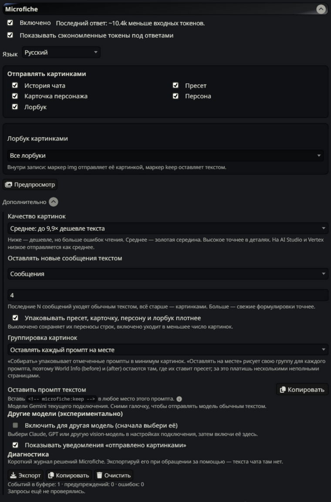
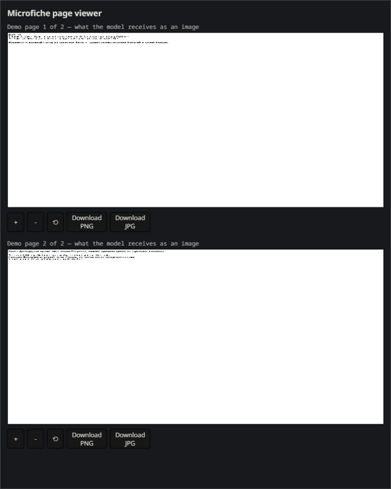
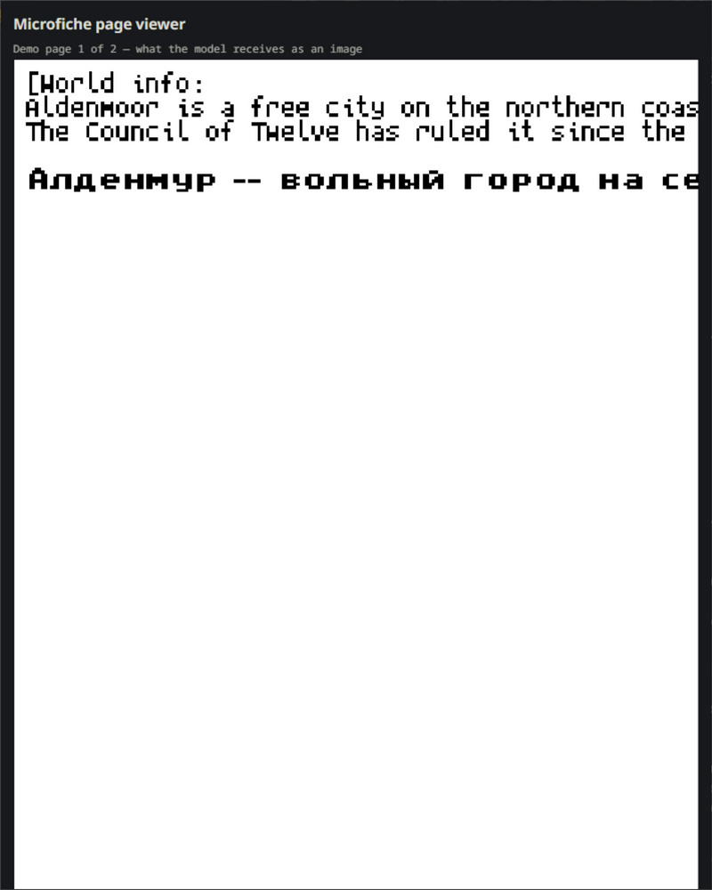

# Microfiche: промпт страницами, счёт за вход дешевле

Microfiche берёт те части промпта, которые модели не нужно цитировать дословно — старую историю чата, пресет, карточку персонажа, описание персоны, лорбуки (world info) — и превращает их в компактные страницы пиксельного шрифта. Страницы уходят в запрос картинками, модель читает их как скан книги. Входящие токены дешевеют до 80%, а свежие сообщения остаются обычным текстом.

Это самостоятельное расширенное издание [Microfiche](https://github.com/cata02222/SillyTavern-Microfiche) автора **cata02222** под той же лицензией AGPL-3.0. От оригинала (v0.3.0) отличается заметно — кратко:

- **Русский интерфейс** — двуязычный RU/EN: следует языку SillyTavern или фиксируется в настройках;
- **Починена конвертация лорбуков** — из-за порядка записей SillyTavern в страницах оказывалась одна запись из блока, теперь уходят все;
- **Просмотрщик страниц** — зум кнопками, Ctrl+колесом и пинчем на телефоне; экспорт страницы в PNG/JPG, всего набора — одним PDF;
- **Уведомления** — «отправлено картинками» на каждом запросе (отключаемо), предупреждения о модели без картинок и о неотмеченном лорбуке: ничего не деградирует молча;
- **Безопасность промпта** — фоновые запросы других расширений и inline-base64 в сообщениях больше не ломают страницы, глубинные записи не крадут текст;
- **Гранулярность лорбуков** — все книги или только выбранные, маркеры `img`/`keep` внутри записей;
- **Хвост чата текстом** — по числу сообщений или по токен-бюджету;
- **Аудит полезной нагрузки и диагностика** — карта вложений (позиция → страница → сообщения), сверка сборки промпта с отправкой, экспорт лога без текста чата;
- **Другие модели** — Claude, GPT и прочие vision-модели через opt-in с настраиваемой оценкой токенов на страницу;
- **Конвертер старых форматов книг** (`tools/convert-lorebooks.mjs`) и **145 тестов**.

Полный разбор с техническими деталями — в [DIFFERENCES.md](DIFFERENCES.md).

[English](README.en.md) · **Русский**

| Настройки | Просмотрщик страниц | Приближённая страница |
|---|---|---|
|  |  |  |

## Как это работает

Gemini тарифицирует картинки по разрешению и хорошо читает в них текст, поэтому страница стоит в разы дешевле того же текста. Microfiche рендерит выбранные блоки промпта в однобитные битмапы (PNG, для Gemini — PDF), подставляет их на место этих блоков, а всё, что модель должна цитировать, — свежие сообщения, помеченные промпты — оставляет текстом.

## Сколько это экономит

Грубо по самим страницам (до накладных расходов и кэша): **Low — примерно на 95% меньше входных токенов, Medium — на 90%, High — на 80%** по сравнению с обычной отправкой текста. В тесте на запоминание сюжета, который провёл автор оригинала, Medium и High верно отвечали на 29 вопросов из 30, Low — на 21 из 30; бери Medium, если важна каждая деталь.

На месячном счёте (длинный чат, замеры автора оригинала): с кэшем примерно **$385 превращаются в $51–110** в зависимости от качества — **экономия 71–87%**; стиль игры с постоянными ветками — около **40–54%**. Для масштаба: в моём повседневном чате это издание срезает около **10.4k входных токенов за запрос** (цифра на скриншоте настроек выше).

Конкретика зависит от промпта, длины чата, кэша и провайдера. Полная методика и таблицы — в [README оригинала](https://github.com/cata02222/SillyTavern-Microfiche#how-much-can-it-save).

## Что нужно

- SillyTavern с Chat Completion.
- Модель, принимающая картинки: Gemini работает сразу; Claude, GPT и остальные — через включение в **Advanced → Other models (experimental)**.

## Установка

В SillyTavern: **Extensions → Install extension**, вставить:

```text
https://github.com/AlhenaaS/SillyTavern-Microfiche
```

Вручную: скопировать содержимое репозитория в `data/<пользователь>/extensions/SillyTavern-Microfiche/` и перезапустить.

## Первый запуск

1. Открой блок **Microfiche** в настройках расширений и включи **Включено**.
2. В **Отправлять картинками** выбери, что превращать в страницы. Самая большая экономия — история чата; лорбук и пресет по желанию.
3. На Gemini выбери **Качество картинок** (Low/Medium/High; Medium — разумный дефолт). На других моделях включи их в **Other models (experimental)** и задай оценку токенов на страницу.
4. Нажми **Предпросмотр** — увидишь страницы, которые ушли бы в следующий запрос, ничего не отправляя.

## Лорбук страницами

При включённом **Лорбук** можно отправлять все лорбуки или только отмеченные. Внутри записи `<!-- microfiche:img -->` заставляет отправить её картинкой, `<!-- microfiche:keep -->` — оставить текстом. Записи, которые не удалось атрибутировать, всегда уходят текстом: потерять текст лорбука хуже, чем не сэкономить, поэтому сплиттер не угадывает.

Если активная книга не отмечена — придёт предупреждение с её именем, ничего не деградирует молча.

## Просмотрщик и экспорт

Клик по иконке страницы у сообщения открывает страницы, с которыми оно ушло:

- кнопки **＋ / － / ⟲** зумят, Ctrl+колесо — плавный шаг на десктопе, обычное колесо скроллит как раньше;
- на тач-экранах: пинч — зум, один палец двигает страницу, двойной тап — сброс;
- каждую страницу можно скачать как **PNG** или **JPG**, а весь набор — одним **PDF**, который открывается в любом читателе; удобно, когда шрифт в приложении кажется мелким.

## Уведомления

- Тост после каждой конвертации (свайпы тоже) — отключается тумблером **Notifications** в настройках.
- Предупреждение, если у текущей модели выключены картинки — запрос ушёл обычным текстом.
- Предупреждение с именем активного, но неотмеченного лорбука.

## Старые лорбуки

Книги, у которых `entries` — массив (старые экспорты, лорбуки NovelAI), SillyTavern читает как есть. Если нужен канонический вид:

```text
node tools/convert-lorebooks.mjs --check    # только показать
node tools/convert-lorebooks.mjs            # конвертировать, с бэкапами
```

## Тесты

Чистые модули покрыты тестами Node:

```text
node --test tests/*.test.js
```

## Отличия от оригинала

Всё, что это издание меняет, чинит и добавляет — в [DIFFERENCES.md](DIFFERENCES.md).

## Лицензия и авторы

AGPL-3.0, унаследована от оригинала ([LICENSE](LICENSE)). Оригинальное расширение — cata02222; изменения этого издания — AlhenaaS.

Шрифты: Spleen 5×8 автора Frederic Cambus, BSD 2-Clause (`licenses/LICENSE-spleen`); кириллица и пунктуация — unscii-8 автора viznut, public domain. Названия эмодзи — Unicode Emoji 17.0.
